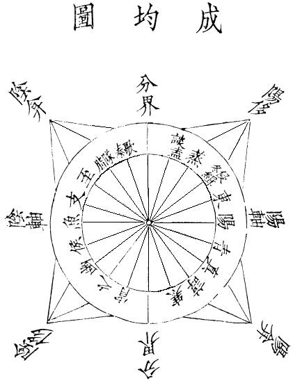

# Corpus 建设与中国思想阅读路线

本仓库建设可持续扩展的古文底文，不建立课程、译注数据库或版本校勘系统。一致性、自动化、覆盖面优先。Corpus 回答“拥有哪些文本”，路线回答“先读什么、为什么读”。整部入库不等于要求整部阅读。

`corpus/targets.json` 是收录意图，只需 `id`、`title`，可选 `priority`（缺省 P1）。`corpus/overrides.json` 只保存版本根、来源例外、别名和少量完整性断言。`corpus/route.json` 单独保存 Stage 0–9 的问题、阅读建议及扩展作品；它是编辑规划，不是产品路径或 Learn 内容。P2 和 bonus 作品不自动成为核心路线。

## 运行

在仓库根目录使用 Node.js 22.12+ 与 `npm ci`：

```sh
npm run corpus:sync -- chuanxilu
npm run corpus:sync
npm run corpus:sync -- --bootstrap
npm run corpus:report
npm run check:content
npm test
npm run build
```

`--bootstrap` 用于初次批量铺底：先匹配固定提交的整书 JSON/TXT，没有匹配时再走 Wiki。它不替换已入库来源；本次在实际遇到 API 限流后使用该模式完成覆盖。普通 sync 仍从 Wiki 开始，收录清单按 P0、P1、P2 处理。

也可分阶段执行 `corpus:discover`、`corpus:fetch`、`corpus:build`、`corpus:check`，均可给前三个命令追加 `-- <id>`。Discover 保存发现计划；fetch 下载计划中的固定来源；build 只使用缓存，缺缓存时提示先 fetch；check 离线检查已入库正文与 source manifest。Sync 对不同作品独立处理，失败返回非零退出码，其他作品继续完成。Report 汇总已入库数据与异常，不能代替检查。

新增作品示例：在 targets 增加 `{"id":"example","title":"作品名"}`，运行 `npm run corpus:sync -- example`。只有发现歧义或确实存在例外时才加 override；不要人工列每章 URL。

## 来源与可重复性

长期首选中文 Wikisource，其次为 Gujilab；Kanripo 作为复杂版本后备，nk2028 为诸子补充，其他公开 corpus 补缺。当前真正实现 Wikisource、Gujilab 及因实际限流/缺页需要而使用的 GitHub JSON/TXT 适配，不建立 Kanripo 或 CText 批量抓取框架。

四书五经和低成本 bonus 优先复用 Gujilab 已有结构。Wikisource 从标题、重定向、目录链接、子页面前缀发现章节，批量查询 revision，再取得固定 revision 的渲染正文。目录模板中的链接保留，header 中的交叉引用排除。大型目录若有匹配的结构化全书，可作为 bootstrap 改用 Gujilab/Guopop；失败时依次尝试可用的结构化 corpus、nk2028、其他公开整书来源。始终整书选一个主要上游，理由保存在 manifest；不逐章拼凑。

`src/books` 仍是唯一 canonical tree。`sources/corpus/<id>.json` 保存 provider、page ID、revision/commit、源时间、获取时间、父子关系、来源 URL、许可声明、正文摘要与统计。原始 API/HTML/JSON/TXT 缓存在 `.cache/wuhua-corpus`，忽略于 Git，可删除。来源字形保留，标题匹配可使用繁简转换，但正文不转换。来源所含古注也可能保留；这不等于新增现代译注。

已入库作品 sync 默认重用固定 manifest，不追随上游最新修订。相同 revision 与缓存重建应无 diff；发现正文变化时只写缓存候选并报错，真实修订仍走历史契约。MediaWiki oldid 固定正文页但不会固定其模板依赖，渲染 HTML 的摘要用于发现这种漂移，发生时需检查，不宣称 oldid 能冻结整个 MediaWiki 渲染环境。

许可和作者信息自动记录，缺失标记 `needsReview` 或 warning，不阻塞本阶段。没有调用付费 LLM；作者、时代、类型来自上游字段，缺失不猜写。未来可补充受 schema 约束的 metadata，但 LLM 不得生成、修复或覆盖 canonical 原文。

## 结构与质量

沿用 `TextBook / Chapter / Paragraph`。为兼容已有消费者，`chapters` 是有序正文单元；`kind: work` 表示短作品本身，不制造“第一章”，`number` 只表示顺序。真实上级卷目保存在 `path`，段落节标题保存在 `headingPath`。当目标本身是集注、章句等注书时，上游的古注字段也导入，并标记段落 `role: source-commentary`；普通正文选本只取主文本字段。古文观止保留 anthology identity，篇目可标为 anthology item。允许大学、中庸在不同 collection context 重复存在，本阶段不做实体对齐。

ID 由作品 ID、provider 与源记录身份确定性派生，段落序号在固定来源内稳定，正文版本为内容摘要。它保证同修订可重跑，不声称新增段落后所有位置 ID 自动不变；因此自动覆盖已有 canonical 被禁止。旧三书继续使用原有 ID、版本、history 和固定来源校验。

自动检查覆盖唯一 ID、固定来源、manifest 对应、正文版本、非空单元、模板/UI 污染、源缺字及异常短章。结构化上游的记录数量和 Wiki 发现范围可核对，但机器通过不等于古籍学意义上的版本完整。`corpus/report.json` 和下面覆盖表明确每部来源、数量与异常，遗失字形不由模型补写。

## 阅读路线

路线按“问题如何变化”组织，不要求依年代读完全部书。

### Stage 0：既有基础

从日常伦理、道与逍遥建立三种不同的提问方式。

论语选章 → 老子选章 → 庄子内篇；旧引用保持冻结。

### Stage 1：四书五经

修身如何连接政治？先获得仁义、诚、中和、礼与天命的共同语言。

大学全文 → 中庸全文 → 孟子梁惠王、尽心 → 诗经国风选篇 → 尚书政治篇章 → 周易系辞选段 → 礼记学记、礼运 → 春秋与左传对读。

### Stage 2：先秦诸子

当儒家主张受到挑战，兼爱、礼法和权力各自如何解释秩序？

墨子兼爱、非攻 → 荀子劝学、性恶 → 韩非子五蠹、显学；与论语、孟子、老庄比较。

### Stage 3：秦汉思想与帝国

思想进入统一帝国后，个人选择、历史评价和治理如何相互牵动？

史记伯夷列传、项羽本纪、廉颇蔺相如列传选读 → 淮南子原道训、主术训；史记全文只是 corpus 范围。

### Stage 4：魏晋人格与文学

从公共秩序转向人物的言语、姿态、自然观与文学自觉。

世说新语德行、言语、任诞、容止选则 → 陶渊明归去来兮辞 → 文心雕龙原道选段。

### Stage 5：唐宋古文

训练如何叙事、说理、抒情，并辨认同一思想在不同文章形式中的力量。

古文观止中师说、捕蛇者说、醉翁亭记、前赤壁赋、岳阳楼记；再到原作者文集扩展。

### Stage 6：宋明理学的前提

从孟子的心性进入理、气、敬、格物的体系，理解心学争论为何发生。

太极图说 → 通书 → 西铭 → 正蒙选章 → 近思录道体与为学 → 四书章句集注中大学章句；陆九渊作为进入阳明前的桥梁。

### Stage 7：王阳明

心即理、知行合一与致良知如何成为修养实践，而非只是一组口号？

传习录卷上徐爱所录 → 卷中答顾东桥书 → 卷下选段；对照朱熹格物说，回到实际行动中的分歧。

### Stage 8：明清思想转向

易代经验如何推动制度反思、经世、史论与概念考辨？

明夷待访录原君、原臣、原法、学校 → 日知录经世选条 → 读通鉴论史论选篇 → 孟子字义疏证理与欲。

### Stage 9：晚清至近代

古文如何承载进化、国家、国民与世界等新问题？

天演论导言与严复按语选段 → 新民说公德、国家思想、自由 → 少年中国说；以人间词话观察近代批评语言。


## 覆盖与异常

下表由本次实际入库结果生成。字数为正文去空白后的 Unicode 码点数，含标点及来源中保留的古注；不是净汉字数。固定修订、详细 warning 和 unresolved 原因见 [机器报告](../corpus/report.json)，逐页来源见 `sources/corpus/`。旧三书另计，未重新导入。

当前新增 **70 部**：P0 29/29、P1 32/32、P2/bonus 9 部。另有冻结三书，总计 73 部。新增正文 13,173,504 码点，含旧三书共 13,281,582 码点；196 个已固定来源单元全部获取，另含 1 个图像章节。真正空章节为 0。

P0 成功名单：《大學》、《中庸》、《孟子》、《周易》、《尚書》、《詩經》、《禮記》、《春秋》、《春秋左氏傳》、《墨子》、《荀子》、《韓非子》、《史記》、《淮南子》、《世說新語》、《古文觀止》、《太極圖說》、《通書》、《正蒙》、《西銘》、《近思錄》、《四書章句集注》、《傳習錄》、《明夷待訪錄》、《日知錄》、《讀通鑑論》、《孟子字義疏證》、《天演論》、《新民說》。

P1 自动取得名单：《列子》、《管子》、《孫子兵法》、《公孫龍子》、《商君書》、《呂氏春秋》、《鹽鐵論》、《論衡》、《春秋繁露》、《說苑》、《新序》、《抱朴子內篇》、《文心雕龍》、《陶淵明集》、《昌黎先生集》、《柳河東集》、《歐陽文忠公集》、《東坡全集》、《河南程氏遺書》、《陸九淵集》、《朱子語類》、《王文成公全書》、《焚書》、《顏元集》、《曾國藩家書》、《龔自珍集》、《少年中國說》、《原強》、《大同書》、《人間詞話》、《海國圖志》、《國故論衡》。

当前 unresolved 为 0。《國故論衡》已按 25 个文字单元和 1 个图像单元入库；整卷汇总页仍排除，避免与独立篇章重复。

质量提示：来源中存在缺字/私用区字形、历史佚篇标记和短序。TXT 的卷号缺口也会提示，有些是标题与正文连排而非确定缺文。所有异常按书保留；没有让模型补字、重写或静默现代化。Gujilab 的补入篇章保留其上游记录顺序。抽样额外排除了《正蒙》备用文本附入的现代论文，并核实《四書章句集注》的朱熹古注没有被丢弃。

| 级别 | 作品 | 主要上游 / 固定修订 | 单元 | 段落 | 码点 | 提示数 |
|---|---|---|---:|---:|---:|---:|
| P0 | 大學 | [gujilab](../sources/corpus/daxue.json) | 1 | 16 | 2,209 | 1 |
| P0 | 中庸 | [gujilab](../sources/corpus/zhongyong.json) | 1 | 39 | 4,456 | 1 |
| P0 | 孟子 | [gujilab](../sources/corpus/mengzi.json) | 14 | 690 | 44,844 | 1 |
| P0 | 周易 | [gujilab](../sources/corpus/zhouyi.json) | 69 | 1270 | 33,339 | 2 |
| P0 | 尚書 | [gujilab](../sources/corpus/shangshu.json) | 57 | 460 | 35,027 | 1 |
| P0 | 詩經 | [gujilab](../sources/corpus/shijing.json) | 305 | 1319 | 36,941 | 2 |
| P0 | 禮記 | [gujilab](../sources/corpus/liji.json) | 47 | 1732 | 121,126 | 2 |
| P0 | 春秋 | [zhwikisource](../sources/corpus/chunqiu.json) | 12 | 517 | 20,921 | 0 |
| P0 | 春秋左氏傳 | [gujilab](../sources/corpus/zuozhuan.json) | 12 | 3296 | 252,286 | 3 |
| P0 | 墨子 | [guopop](../sources/corpus/mozi.json) | 63 | 67 | 92,322 | 10 |
| P0 | 荀子 | [guopop](../sources/corpus/xunzi.json) | 34 | 3590 | 95,263 | 4 |
| P0 | 韓非子 | [guopop](../sources/corpus/hanfeizi.json) | 57 | 1258 | 129,143 | 2 |
| P1 | 列子 | [zhwikisource](../sources/corpus/liezi.json) | 8 | 139 | 37,948 | 0 |
| P1 | 管子 | [guopop](../sources/corpus/guanzi.json) | 89 | 5140 | 155,524 | 14 |
| P1 | 孫子兵法 | [zhwikisource](../sources/corpus/sunzi.json) | 1 | 90 | 10,164 | 0 |
| P1 | 公孫龍子 | [zhwikisource](../sources/corpus/gongsunlongzi.json) | 7 | 37 | 11,460 | 0 |
| P1 | 商君書 | [zhwikisource](../sources/corpus/shangjunshu.json) | 5 | 128 | 24,209 | 0 |
| P1 | 呂氏春秋 | [zhwikisource](../sources/corpus/lvshichunqiu.json) | 26 | 749 | 131,537 | 1 |
| P0 | 史記 | [gujilab](../sources/corpus/shiji.json) | 130 | 4348 | 1,094,693 | 133 |
| P0 | 淮南子 | [guopop](../sources/corpus/huainanzi.json) | 22 | 4834 | 158,387 | 2 |
| P1 | 鹽鐵論 | [guopop](../sources/corpus/yantielun.json) | 61 | 62 | 59,546 | 2 |
| P1 | 論衡 | [guopop](../sources/corpus/lunheng.json) | 85 | 194 | 257,342 | 2 |
| P1 | 春秋繁露 | [daizhige](../sources/corpus/chunqiufanlu.json) | 18 | 249 | 71,777 | 10 |
| P1 | 說苑 | [guopop](../sources/corpus/shuoyuan.json) | 21 | 746 | 130,410 | 2 |
| P1 | 新序 | [guopop](../sources/corpus/xinxu.json) | 11 | 211 | 57,985 | 2 |
| P2 | 漢書 | [gujilab](../sources/corpus/hanshu.json) | 101 | 3808 | 891,475 | 65 |
| P0 | 世說新語 | [guopop](../sources/corpus/shishuoxinyu.json) | 74 | 2880 | 83,204 | 13 |
| P1 | 抱朴子內篇 | [daizhige](../sources/corpus/baopuzi.json) | 1 | 426 | 103,147 | 2 |
| P1 | 文心雕龍 | [guopop](../sources/corpus/wenxindiaolong.json) | 51 | 101 | 45,662 | 3 |
| P1 | 陶淵明集 | [guopop](../sources/corpus/taoyuanmingji.json) | 13 | 1145 | 44,651 | 2 |
| P0 | 古文觀止 | [guopop](../sources/corpus/guwenguanzhi.json) | 225 | 8035 | 129,676 | 1 |
| P1 | 昌黎先生集 | [guopop](../sources/corpus/hanyuji.json) | 58 | 8927 | 249,243 | 3 |
| P1 | 柳河東集 | [guopop](../sources/corpus/liuzongyuanji.json) | 53 | 7212 | 260,637 | 2 |
| P1 | 歐陽文忠公集 | [guopop](../sources/corpus/ouyangxiuji.json) | 168 | 19236 | 976,548 | 26 |
| P1 | 東坡全集 | [guopop](../sources/corpus/sushiji.json) | 63 | 3811 | 291,492 | 5 |
| P0 | 太極圖說 | [zhwikisource](../sources/corpus/taijitushuo.json) | 1 | 1 | 341 | 0 |
| P0 | 通書 | [zhwikisource](../sources/corpus/tongshu.json) | 1 | 40 | 3,380 | 0 |
| P0 | 正蒙 | [zhwikisource](../sources/corpus/zhengmeng.json) | 19 | 539 | 27,321 | 0 |
| P0 | 西銘 | [zhwikisource](../sources/corpus/ximing.json) | 1 | 1 | 320 | 0 |
| P0 | 近思錄 | [daizhige](../sources/corpus/jinsilu.json) | 15 | 585 | 101,206 | 13 |
| P0 | 四書章句集注 | [guopop](../sources/corpus/sishuzhangjujizhu.json) | 40 | 4330 | 251,299 | 3 |
| P1 | 河南程氏遺書 | [daizhige](../sources/corpus/erchengyishu.json) | 25 | 2206 | 185,778 | 4 |
| P1 | 陸九淵集 | [daizhige](../sources/corpus/lujiuyuanji.json) | 6 | 1755 | 207,620 | 6 |
| P1 | 朱子語類 | [daizhige](../sources/corpus/zhuziyulei.json) | 141 | 15653 | 1,933,088 | 33 |
| P0 | 傳習錄 | [zhwikisource](../sources/corpus/chuanxilu.json) | 3 | 955 | 80,532 | 0 |
| P1 | 王文成公全書 | [daizhige](../sources/corpus/wangwenchenggongquanshu.json) | 9 | 4232 | 678,268 | 11 |
| P0 | 明夷待訪錄 | [zhwikisource](../sources/corpus/mingyidaifanglu.json) | 1 | 115 | 22,766 | 0 |
| P0 | 日知錄 | [daizhige](../sources/corpus/rizhilu.json) | 33 | 2268 | 497,601 | 33 |
| P0 | 讀通鑑論 | [daizhige](../sources/corpus/dutongjianlun.json) | 6 | 3662 | 555,399 | 8 |
| P0 | 孟子字義疏證 | [daizhige](../sources/corpus/mengziziyishuzheng.json) | 4 | 92 | 37,887 | 1 |
| P1 | 焚書 | [daizhige](../sources/corpus/fenshu.json) | 9 | 1498 | 159,423 | 6 |
| P1 | 顏元集 | [daizhige](../sources/corpus/yanyuanji.json) | 29 | 1598 | 233,534 | 17 |
| P1 | 曾國藩家書 | [daizhige](../sources/corpus/zengguofanjiashu.json) | 1 | 883 | 102,723 | 2 |
| P1 | 龔自珍集 | [daizhige](../sources/corpus/gongzizhenji.json) | 1 | 908 | 138,539 | 3 |
| P0 | 天演論 | [daizhige](../sources/corpus/tianyanlun.json) | 39 | 339 | 115,173 | 5 |
| P0 | 新民說 | [zhwikisource](../sources/corpus/xinminshuo.json) | 20 | 299 | 116,918 | 9 |
| P1 | 少年中國說 | [zhwikisource](../sources/corpus/shaonianzhongguoshuo.json) | 1 | 11 | 3,790 | 0 |
| P1 | 原強 | [zhwikisource](../sources/corpus/yuanqiang.json) | 1 | 48 | 20,622 | 1 |
| P1 | 大同書 | [daizhige](../sources/corpus/datongshu.json) | 1 | 979 | 189,737 | 2 |
| P1 | 人間詞話 | [daizhige](../sources/corpus/renjiancihua.json) | 1 | 130 | 5,311 | 2 |
| P1 | 海國圖志 | [daizhige](../sources/corpus/haiguotuzhi.json) | 1 | 9031 | 202,072 | 2 |
| P1 | 國故論衡 | [zhwikisource](../sources/corpus/guguolunheng.json) | 26（含图像 1） | 411 | 95,400 | 8 |
| P2 | 春秋公羊傳 | [gujilab](../sources/corpus/gongyang.json) | 12 | 2545 | 67,288 | 4 |
| P2 | 春秋穀梁傳 | [gujilab](../sources/corpus/guliang.json) | 12 | 735 | 40,740 | 1 |
| P2 | 孝經 | [gujilab](../sources/corpus/xiaojing.json) | 18 | 23 | 2,267 | 1 |
| P2 | 爾雅 | [gujilab](../sources/corpus/erya.json) | 19 | 1605 | 15,306 | 5 |
| P2 | 周禮 | [guopop](../sources/corpus/zhouli.json) | 12 | 2966 | 61,024 | 4 |
| P2 | 儀禮 | [guopop](../sources/corpus/yili.json) | 17 | 3471 | 72,362 | 4 |
| P2 | 臨川文集 | [guopop](../sources/corpus/wanganshiji.json) | 106 | 11749 | 503,971 | 11 |
| P2 | 元豐類稿 | [guopop](../sources/corpus/zenggongji.json) | 56 | 3704 | 299,904 | 29 |

## 图像页与试读验证

`kind: image` 的 chapter 使用 `images` 保存原图，`paragraphs` 留空，不能填入“[图片]”占位正文。每张图有稳定 ID、内容版本、来源页 oldid、文件时间和校验值、尺寸、署名许可及 `assets/<sha256>.jpg|png` 路径。当前支持 JPEG/PNG 的图像专页；混排页仍沿用正文提取规则，不会借本次任务自动修改已入库底文。没有 OCR 或生成图像。

图像发现仅识别正文的 File 链接，排除导航图标。抓取 Commons 中不晚于来源页修订时间的文件版本，先核对上游 SHA-1，再保存原始字节与 SHA-256。`corpus:check` 核验文件和来源清单，空白但没有有效图片的页面仍失败。`findImage` 可解析图片身份，`findReference` 继续只解析文字引用。

资产随 build 复制至 `lib/src/assets`，本地 release 打包至 `releases/<release>/assets`。未来产品升级应复制这些资产，并将相对路径解析为同 release 的 URL；不要把图片图题当正文朗读。当前产品 vendor 和页面未修改。



原图：[《成均圖》来源页](https://zh.wikisource.org/w/index.php?oldid=2362297)。Commons 上传者 Sowhat666，所记录许可为 [CC BY-SA 4.0](https://creativecommons.org/licenses/by-sa/4.0)。保留原图，没有重绘或识读填字。

三书六个试读样本见 [阅读路线试读](route-pilot.md)，固定引用与选段范围在 `corpus/route-pilot.json`。运行 `npm run corpus:route:check` 验证，运行 `npm run corpus:route:preview` 从 canonical 重新生成预览。此检查也纳入 `check:content`。样本不进入产品课程，不宣称已验证真实读者的学习效果。
